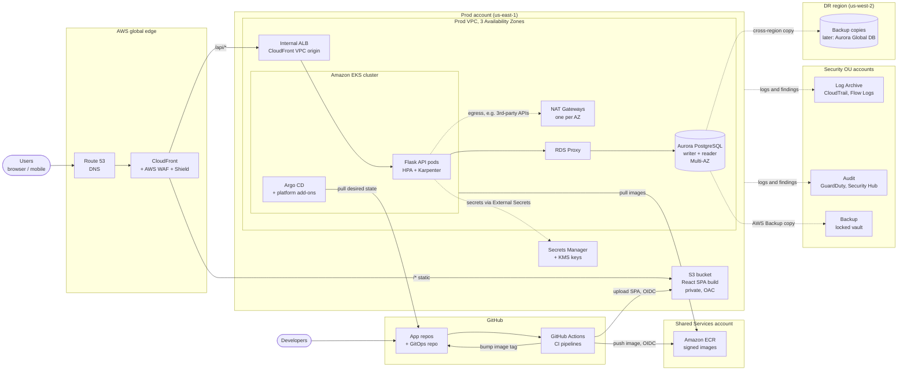
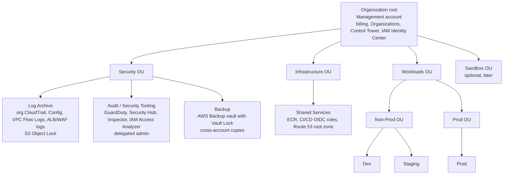
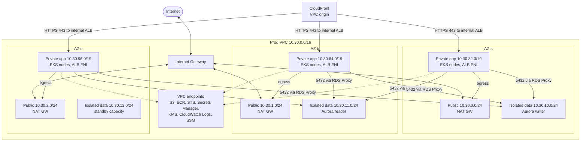
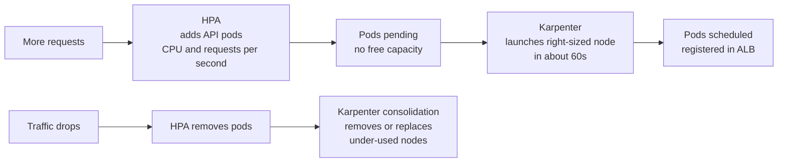
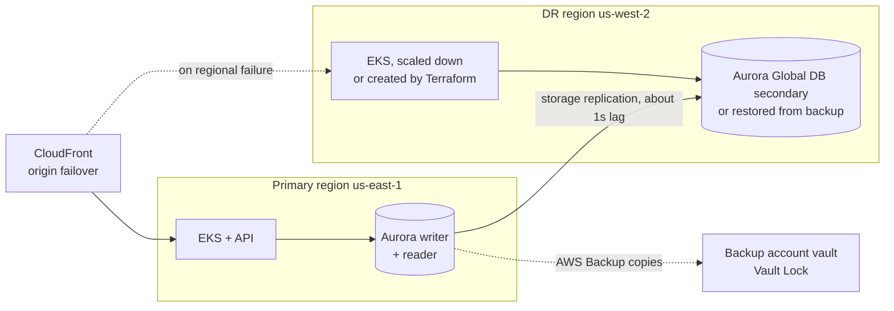

# Innovate Inc. — Cloud Architecture Design

| | |
|---|---|
| **Client** | Innovate Inc. |
| **Cloud provider** | Amazon Web Services (AWS) |
| **Workload** | React SPA + Python/Flask REST API + PostgreSQL |
| **Primary / DR region** | `us-east-1` / `us-west-2` (adjust to where users and data-residency requirements are) |
| **Status** | Proposal |

---

## Table of Contents

1. [Executive Summary](#1-executive-summary)
2. [Requirements and Design Principles](#2-requirements-and-design-principles)
3. [High-Level Architecture](#3-high-level-architecture)
4. [Cloud Environment Structure](#4-cloud-environment-structure)
5. [Network Design](#5-network-design)
6. [Compute Platform (Amazon EKS)](#6-compute-platform-amazon-eks)
7. [Containerization and CI/CD](#7-containerization-and-cicd)
8. [Database](#8-database)
9. [Security Summary](#9-security-summary)
10. [Observability](#10-observability)
11. [Cost Management](#11-cost-management)
12. [Growth Roadmap](#12-growth-roadmap)
13. [Assumptions and Open Questions](#13-assumptions-and-open-questions)

---

## 1. Executive Summary

Innovate Inc. is a small team with limited cloud experience that handles sensitive user data, starts with a few hundred users per day, and expects to grow to millions. The design therefore optimises for:

- **Managed services first.** The team runs the application, not the infrastructure: Amazon EKS, Aurora PostgreSQL, CloudFront, ECR, Secrets Manager, and AWS-native security services.
- **Start small, scale without re-architecture.** Every component can scale automatically from a low-cost baseline (Aurora Serverless v2, Karpenter-provisioned nodes, CloudFront for static content), so the step from hundreds to millions of users is mostly configuration, not redesign.
- **Security by default.** Isolated AWS accounts per environment, private networking, encryption at rest and in transit with customer-managed KMS keys, no long-lived credentials anywhere (SSO for humans, OIDC and Pod Identity for machines), and organisation-wide detective controls.
- **Everything as code.** Infrastructure in Terraform, application delivery through GitOps (Argo CD), so every change is reviewed, auditable and reversible.

Key decisions at a glance:

| Area | Decision |
|---|---|
| Accounts | AWS Organizations + Control Tower, 8 accounts: Management, Log Archive, Audit, Backup, Shared Services, Dev, Staging, Prod |
| Network | One VPC per environment across 3 AZs with public, private-app and isolated-data subnet tiers; no public load balancer (CloudFront VPC origin) |
| Frontend | React SPA served from private S3 through CloudFront (not from Kubernetes) |
| Compute | Amazon EKS; a small managed node group for system add-ons plus Karpenter for application capacity (Graviton, Spot where safe) |
| Delivery | GitHub Actions (CI, OIDC to AWS) → ECR (signed, scanned, immutable images) → Argo CD (GitOps CD) with Argo Rollouts canaries in prod |
| Database | Amazon Aurora PostgreSQL (Serverless v2), Multi-AZ, RDS Proxy, PITR, cross-account and cross-region backups, Aurora Global Database as the growth-stage DR option |

---

## 2. Requirements and Design Principles

| Requirement | How the design addresses it |
|---|---|
| **Robust** | Multi-AZ everything in prod (EKS nodes, ALB, NAT, Aurora); PodDisruptionBudgets and topology spread; automated rollbacks; tested backups and a documented DR plan |
| **Scalable** | Stateless API on EKS with HPA + Karpenter; Aurora Serverless v2 and read replicas; static frontend on a global CDN; clear growth roadmap (§12) |
| **Secure** | Account isolation, SCP guardrails, private subnets, WAF, least-privilege IAM, KMS encryption, Secrets Manager, image signing, GuardDuty/Security Hub |
| **Cost-effective** | Serverless and autoscaling baselines, Graviton and Spot, right-sized non-prod environments, single NAT in non-prod, VPC endpoints, budgets and alerts per account |
| **Managed Kubernetes** | Amazon EKS with managed add-ons, EKS access entries, Pod Identity |
| **CI/CD** | Trunk-based development, automated build/test/scan, GitOps promotion dev → staging → prod |
| **Low team experience** | Prefer managed services, fewer moving parts, opinionated golden paths, everything codified and documented |

---

## 3. High-Level Architecture



**Request flow.** A user resolves the domain through Route 53 and reaches CloudFront. CloudFront applies AWS WAF rules and then routes by path:

- `/*` → the React SPA in a **private** S3 bucket (Origin Access Control, so the bucket is never public).
- `/api/*` → an **internal** Application Load Balancer inside the VPC, reached through a [CloudFront VPC origin](https://docs.aws.amazon.com/AmazonCloudFront/latest/DeveloperGuide/private-content-vpc-origins.html). The ALB has no public IP and cannot be reached from the internet directly.

The ALB forwards to Flask pods on EKS, which connect to Aurora PostgreSQL through RDS Proxy. Serving frontend and API from the **same domain** removes CORS complexity and lets one WAF policy protect both.

**Why the SPA is not on Kubernetes.** A built React app is a set of static files. S3 + CloudFront serves them from edge locations close to users, scales to millions of users with no capacity planning, costs cents at low traffic, and removes a whole deployment from the cluster. Kubernetes is reserved for what needs it: the API.

---

## 4. Cloud Environment Structure

### 4.1 Recommendation: 8 accounts under AWS Organizations

AWS accounts are free; they are the strongest isolation boundary AWS offers (separate IAM, quotas, billing and blast radius). The setup is bootstrapped with **AWS Control Tower** (landing zone), which creates the Management, Log Archive and Audit accounts and applies baseline guardrails automatically, which is ideal for a team with limited cloud experience.



| Account | Purpose | Why separate |
|---|---|---|
| **Management** | Billing (consolidated), AWS Organizations, Control Tower, IAM Identity Center (SSO). **No workloads.** | Most privileged account; keep it nearly empty and rarely used |
| **Log Archive** | Immutable, centralised logs: organisation CloudTrail, AWS Config, VPC Flow Logs, ALB/WAF/CloudFront logs | An attacker or mistake in a workload account cannot delete the audit trail |
| **Audit (Security Tooling)** | Delegated admin for GuardDuty, Security Hub, Inspector, IAM Access Analyzer, Config aggregator | Security team gets an org-wide view without access to workloads |
| **Backup** | Central AWS Backup vault with Vault Lock (WORM) receiving copies of prod backups | Backups survive compromise or accidental deletion of the Prod account (ransomware protection) |
| **Shared Services** | ECR registry, GitHub Actions OIDC roles, root DNS zone, shared tooling | Build once, deploy the **same image** everywhere; CI never needs write access to Prod |
| **Dev** | Developer integration environment, cost-optimised | Experiments cannot affect staging or prod |
| **Staging** | Production-like pre-release environment for E2E, load and security tests | Validates infra and app changes exactly as they will run in prod |
| **Prod** | Production workloads and sensitive user data only | Smallest possible set of people and pipelines can touch it; cleanest compliance scope |

**Smaller starting point.** If eight accounts feel like too much on day one, the minimum is Control Tower's three plus **Dev** and **Prod**; Shared Services, Staging and Backup can be added before the first paying customers. The account and OU structure above is the target; nothing in it has to be redesigned later.

### 4.2 Isolation, billing and management

- **Identity.** IAM Identity Center (SSO) with permission sets (e.g. `ReadOnly`, `Developer`, `PlatformAdmin`, `BreakGlass`), backed by the company IdP (Google Workspace / Okta / Entra ID) with MFA enforced. No IAM users or long-lived access keys. Developers have broad access in Dev, read-only in Prod; production changes go through pipelines.
- **Guardrails (Service Control Policies).**
  - Deny leaving the organisation, and deny disabling CloudTrail, Config, GuardDuty or Security Hub.
  - Restrict usage to approved regions (primary + DR).
  - Deny root-user actions in member accounts.
  - Deny creating unencrypted EBS volumes, RDS instances and S3 buckets.
  - Prod OU: deny IAM user/access-key creation and deny deleting backups/KMS keys outside the break-glass role.
- **Billing.** Consolidated billing in the Management account gives one invoice with per-account breakdown, so cost per environment is visible with zero tagging effort. On top of that: mandatory tags (`env`, `service`, `owner`, `cost-center`) enforced by tag policies, AWS Budgets with alerts per account, and Cost Anomaly Detection.
- **Provisioning.** New accounts are created from a template (Control Tower Account Factory, or Account Factory for Terraform) so every account gets the same baseline: SSO access, logging, GuardDuty, a default-deny network baseline and budgets.

---

## 5. Network Design

### 5.1 VPC architecture

One VPC per workload account (Dev, Staging, Prod), each spanning **three Availability Zones**, with non-overlapping CIDR ranges so environments can be connected later (Transit Gateway / VPC peering) without re-addressing.

| Environment | VPC CIDR | Notes |
|---|---|---|
| Dev | `10.10.0.0/16` | Can run in 2 AZs with a single NAT Gateway to save cost |
| Staging | `10.20.0.0/16` | Mirrors prod topology (3 AZs), smaller instance sizes |
| Prod | `10.30.0.0/16` | 3 AZs, NAT Gateway per AZ |
| Reserved | `10.40.0.0/16`+ | DR region, future environments |

Each VPC has three subnet tiers, one subnet per tier per AZ (Prod example):

| Tier | Size per AZ | Example (AZ-a) | Contents | Internet route |
|---|---|---|---|---|
| **Public** | `/24` | `10.30.0.0/24` | NAT Gateways only | Inbound + outbound via Internet Gateway |
| **Private (app)** | `/19` (8,192 IPs) | `10.30.32.0/19` | EKS nodes and pods, internal ALB, VPC endpoint ENIs | Outbound only via NAT Gateway in the same AZ |
| **Isolated (data)** | `/24` | `10.30.10.0/24` | Aurora, RDS Proxy (later ElastiCache) | **None** |

The private subnets are deliberately large because the Amazon VPC CNI gives every pod a real VPC IP; `/19` per AZ with prefix delegation leaves room for thousands of pods without re-addressing.



**Design choices:**

- **No public load balancer.** The ALB is internal and only CloudFront (via VPC origin) can reach it. The only resources in public subnets are NAT Gateways. The ALB is created by Terraform (CloudFront needs its ARN) and the AWS Load Balancer Controller attaches pods to it via `TargetGroupBinding`.
- **NAT Gateway per AZ in prod** so the loss of one AZ does not cut egress for the others; a **single NAT Gateway in dev** to save cost (~$32/month each plus data processing).
- **VPC endpoints** (gateway endpoint for S3; interface endpoints for ECR, STS, Secrets Manager, KMS, CloudWatch Logs, SSM) keep AWS API and image-pull traffic on the AWS network, reduce NAT data charges and allow tighter egress policies.
- **No SSH, no bastion hosts.** Operator access to nodes, if ever needed, is through AWS Systems Manager Session Manager (audited, no open ports). Access to the private EKS API is through AWS Client VPN with SSO, or SSM port forwarding.
- **DNS.** Route 53 public hosted zone for the application domain (delegated from the root zone in Shared Services); ACM certificates for CloudFront (`us-east-1`) and the ALB.

### 5.2 Network security (defence in depth)

| Layer | Control |
|---|---|
| **Edge** | AWS WAF on CloudFront: AWS managed rule groups (Core rule set, Known bad inputs, SQL injection, IP reputation), rate-based rules per IP and on `/api/auth/*`, optional geo restrictions. AWS Shield Standard (DDoS) is included; Shield Advanced can be added later. TLS 1.2+ only; HSTS and security headers via a CloudFront response headers policy |
| **Origin protection** | S3 bucket is private with Block Public Access, reachable only via CloudFront OAC. ALB is internal and accepts traffic only from the CloudFront VPC-origin security group; HTTPS end-to-end (CloudFront → ALB with ACM certificate) |
| **Subnet** | Three-tier subnet layout; the data tier has no route to the internet. NACLs as a coarse second layer (e.g. data subnets accept 5432 only from app-subnet CIDRs) |
| **Security groups** | Least-privilege, referenced by SG ID rather than CIDR: `CloudFront-origin SG → ALB SG :443`, `ALB SG → app pods :8000`, `app pods → RDS Proxy SG :5432`, `RDS Proxy SG → Aurora SG :5432`. **Security Groups for Pods** so only the API pods (not every pod on the node) can reach the database |
| **Kubernetes** | NetworkPolicies (VPC CNI network policy support) with default-deny per namespace, allowing only required pod-to-pod flows. EKS API endpoint **private only** |
| **Egress** | All outbound traffic leaves through NAT Gateways with VPC endpoints for AWS services. Route 53 Resolver DNS Firewall blocks known-malicious domains. As requirements tighten, AWS Network Firewall can add domain allow-listing |
| **Detection** | VPC Flow Logs → Log Archive; GuardDuty (including EKS Runtime and RDS Protection) analyses flow logs, DNS logs and CloudTrail; findings aggregated in Security Hub with alerting |

---

## 6. Compute Platform (Amazon EKS)

### 6.1 Cluster design

- **One EKS cluster per environment** (dev, staging, prod), each in its own account. Same Terraform module, different sizes. No shared cluster across environments, preserving the account isolation from §4.
- **Private API endpoint**, EKS **access entries** mapped to SSO roles (no `aws-auth` ConfigMap editing), Kubernetes RBAC per namespace.
- **Secrets encryption** with a customer-managed KMS key; control-plane logs (API, audit, authenticator) shipped to CloudWatch.
- **Managed add-ons** kept current by AWS: VPC CNI (with prefix delegation and network policy), CoreDNS, kube-proxy, EBS CSI driver, EKS Pod Identity Agent.
- **Platform add-ons**, installed and versioned via Argo CD:

| Add-on | Purpose |
|---|---|
| Karpenter | Just-in-time node provisioning and consolidation |
| AWS Load Balancer Controller | Registers pods in the ALB target group (`TargetGroupBinding`) |
| External Secrets Operator | Syncs secrets from AWS Secrets Manager into Kubernetes |
| Argo CD + Argo Rollouts | GitOps continuous delivery; canary deployments |
| metrics-server | Resource metrics for HPA |
| Kyverno | Admission policies (signed images only, no `:latest`, resource limits required, Pod Security "restricted") |
| ADOT / Fluent Bit | Metrics, logs and traces to CloudWatch / Amazon Managed Prometheus |

- **Workload identity.** EKS Pod Identity gives each service account its own IAM role (e.g. the API can read only its own secrets and its own S3 prefix). Nodes have a minimal role, and pods are blocked from using the node's instance metadata credentials (IMDSv2, hop limit 1).

**Alternative considered: EKS Auto Mode**, where AWS also manages Karpenter, core add-ons and node AMIs. It further reduces operational effort and is a reasonable choice for a small team; the trade-off is a per-instance management fee and less control. The design below uses self-managed Karpenter but would carry over to Auto Mode with almost no changes.

### 6.2 Node groups

| Node pool | Provisioned by | Instances | Capacity type | Runs |
|---|---|---|---|---|
| **system** | EKS managed node group, 3 nodes (1 per AZ, 2 in dev) | `m7g.large` (Graviton) | On-Demand | Karpenter, CoreDNS, Argo CD, other platform add-ons. Tainted `CriticalAddonsOnly` so application pods never land here |
| **app** | Karpenter `NodePool` | Graviton families `c7g/m7g/r7g` (and newer), sizes large–4xlarge; diversified | Prod: On-Demand baseline with Spot for burst. Dev/Staging: Spot first | Flask API and workers |
| **batch** (when needed) | Karpenter `NodePool` | Compute-optimised, Spot | Spot | Async jobs, reports, data processing |

Rationale:

- **Why a separate system node group:** Karpenter cannot run on nodes it manages itself, and keeping cluster-critical components on stable On-Demand nodes protects them from Spot interruptions and noisy application pods.
- **Why Karpenter for apps:** it picks the cheapest instance type that fits pending pods in seconds, spreads across AZs, consolidates under-used nodes and handles Spot interruptions gracefully, which is a better fit than fixed-size node groups when traffic can grow by orders of magnitude.
- **Graviton (arm64)** gives roughly 20–40% better price/performance for Python workloads; images are built multi-arch (`linux/arm64` + `linux/amd64`) so x86 remains a fallback.
- **Bottlerocket** as node OS: minimal, immutable, container-optimised, with automatic security updates.

### 6.3 Scaling



- **Pod level:** HorizontalPodAutoscaler on CPU (target ~60–70%) and, as traffic grows, on requests-per-second from Prometheus metrics (via KEDA or the Prometheus adapter). Prod minimum of **3 replicas** (one per AZ); dev minimum 1.
- **Node level:** Karpenter adds capacity for pending pods and continuously consolidates. Disruption budgets and `do-not-disrupt` windows protect production during business hours if needed.
- **Database level:** Aurora Serverless v2 scales capacity automatically; RDS Proxy absorbs connection spikes as pods scale out (§8).
- **Edge:** CloudFront and S3 scale automatically for the frontend.
- **Guardrails:** Karpenter `NodePool` CPU/memory limits and AWS Budgets alerts prevent runaway scaling from bugs or attacks.

### 6.4 Resource allocation and workload reliability

- **Namespaces** per application/team (e.g. `api`, `workers`, `platform`) with **ResourceQuotas** and **LimitRanges** so no team can starve the cluster.
- **Requests and limits on every container.** CPU requests set from observed usage; **memory limit = memory request** (memory is not compressible, so this avoids OOM surprises); no CPU limit for latency-sensitive API pods to avoid CFS throttling. Values are reviewed with VPA in recommendation mode and Container Insights.
- **High availability:** `topologySpreadConstraints` across AZs and nodes, **PodDisruptionBudgets** (`maxUnavailable: 1`), readiness/liveness/startup probes, graceful shutdown (`preStop` delay + gunicorn graceful timeout) so in-flight requests finish during deploys and node drains.
- **Priority classes** so platform components and the API are preempted last.
- **Pod Security Standards "restricted"**: non-root, read-only root filesystem, no privilege escalation, dropped capabilities.

### 6.5 Cluster lifecycle

- EKS version upgrades at least twice a year (staying inside standard support to avoid extended-support charges), always dev → staging → prod.
- Add-ons upgraded via Argo CD; nodes roll automatically when Karpenter detects a new AMI (drift), respecting PDBs.
- Large or risky upgrades can be done blue/green by standing up a new cluster from the same Terraform module and shifting traffic at the ALB/CloudFront layer.

---

## 7. Containerization and CI/CD

### 7.1 Image build

**Backend (Flask).** Multi-stage Dockerfile:

```dockerfile
# --- build stage: install dependencies into a virtualenv ---
FROM python:3.12-slim AS build
WORKDIR /app
RUN python -m venv /venv
COPY requirements.txt .
RUN /venv/bin/pip install --no-cache-dir --require-hashes -r requirements.txt

# --- runtime stage: minimal image, non-root ---
FROM python:3.12-slim
ENV PATH="/venv/bin:$PATH" PYTHONDONTWRITEBYTECODE=1 PYTHONUNBUFFERED=1
RUN useradd --uid 10001 --no-create-home app
COPY --from=build /venv /venv
COPY --chown=app:app src/ /app/
WORKDIR /app
USER 10001
EXPOSE 8000
CMD ["gunicorn", "--bind", "0.0.0.0:8000", "--workers", "3", "--graceful-timeout", "30", "wsgi:app"]
```

- Pinned base images (by digest, updated automatically by Renovate/Dependabot) and pinned, hash-locked Python dependencies.
- Production WSGI server (gunicorn); no dev server, no build tools or secrets in the final image.
- Built with Docker Buildx for `linux/arm64` and `linux/amd64`, with layer caching in ECR.
- Configuration via environment variables; secrets injected at runtime (External Secrets → Kubernetes Secret), **never baked into images**.

**Frontend (React).** Built in CI (`npm ci && npm run build`), uploaded to S3 with content-hashed asset filenames and long cache TTLs; `index.html` is served with a short TTL / invalidated on deploy. No container needed.

### 7.2 Registry (Amazon ECR)

- Single ECR registry in the **Shared Services** account. Workload accounts get **pull-only** access via repository policies; only the CI role can push.
- **Immutable tags**: images tagged with the Git commit SHA (plus a semantic version for releases); `latest` is never used.
- **Scanning**: Amazon Inspector enhanced scanning on push and continuously as new CVEs are published; critical findings block promotion.
- **Signing and provenance**: images signed with cosign (or AWS Signer, KMS-backed) and an SBOM attached; Kyverno in each cluster admits only images signed by the CI key and pulled from the company registry.
- **Lifecycle policies** expire untagged and old non-release images to control cost.
- Optional cross-region replication to the DR region.

### 7.3 Pipeline and deployment process

```mermaid
flowchart LR
    pr["Pull request"] --> ci["CI checks<br/>lint, unit tests<br/>SAST, dependency scan<br/>Dockerfile lint, Terraform plan"]
    ci --> merge["Merge to main"]
    merge --> build["Build multi-arch image<br/>scan, sign, SBOM<br/>push to ECR as git SHA"]
    build --> gitops["Update image tag<br/>in GitOps repo, dev"]
    gitops --> devenv["Argo CD syncs Dev<br/>migrations, smoke tests"]
    devenv --> stg["Auto-promote to Staging<br/>E2E, load, DAST tests"]
    stg --> approve{"Release PR<br/>approved?"}
    approve -- "yes" --> prodenv["Argo CD syncs Prod<br/>Argo Rollouts canary<br/>10% to 50% to 100%"]
    prodenv --> analysis{"Error rate and<br/>latency healthy?"}
    analysis -- "yes" --> done["Fully rolled out"]
    analysis -- "no" --> rollback["Automatic rollback"]
```



- **Source and branching.** Trunk-based development with short-lived branches, required reviews, required status checks and branch protection on `main`. A separate **GitOps repository** holds Helm values per environment; it is the single source of truth for what runs where.
- **CI (GitHub Actions).** Authenticates to AWS with **OIDC federation** (no stored AWS keys) and assumes a narrowly scoped role in Shared Services that can only push to ECR and upload SPA builds. Checks include unit tests, linting, SAST (Semgrep/Bandit), dependency and secret scanning, container scanning (Trivy) and `terraform plan` for infrastructure PRs.
- **CD (Argo CD, pull-based GitOps).** Each cluster runs its own Argo CD that **pulls** from Git, so CI never holds credentials to any cluster or to the Prod account. Drift is detected and reverted automatically. Rollback = revert a commit (or one click in Argo CD).
- **Promotion, not rebuild.** The **same image digest** that was tested in dev and staging is promoted to prod by changing a tag in the GitOps repo. Dev deploys automatically on merge, staging automatically after dev smoke tests pass, prod through an approved release PR.
- **Progressive delivery in prod.** Argo Rollouts canary steps with automated analysis of 5xx rate and p95 latency (from Prometheus/CloudWatch); unhealthy canaries are rolled back without human intervention.
- **Database migrations.** Alembic (Flask-Migrate) migrations run as a Kubernetes Job in an Argo CD `PreSync` hook. Migrations follow the **expand/contract** pattern (backward-compatible changes first, cleanup in a later release) so old and new pods can run side by side during canaries and rollbacks.
- **Infrastructure pipeline.** Terraform in a separate repo with remote state (S3 with native locking) per account; `plan` on PR, `apply` on merge through a pipeline role, dev → staging → prod. Policy checks with Checkov/tfsec.

---

## 8. Database

### 8.1 Service choice: Amazon Aurora PostgreSQL

| Option | Pros | Cons | Verdict |
|---|---|---|---|
| PostgreSQL on EKS (operator) or EC2 | Full control, lowest raw compute price | Team owns backups, failover, patching, storage and tuning; high risk for sensitive data with a small, inexperienced team | ❌ Not appropriate |
| Amazon RDS for PostgreSQL (Multi-AZ) | Fully managed, simple, cheaper at steady small sizes | Failover typically 60–120 s; fewer read replicas; manual storage sizing; cross-region DR is replica-based and slower | ✅ Good, but less headroom |
| **Amazon Aurora PostgreSQL** | Fully managed, PostgreSQL-compatible; storage replicated 6 ways across 3 AZs and auto-growing; fast failover (typically ~30 s, less with RDS Proxy); up to 15 low-lag read replicas; **Serverless v2** scales capacity automatically; **Global Database** for cross-region DR | Slightly higher price per unit of capacity; some AWS lock-in (mitigated by PostgreSQL wire compatibility) | ✅ **Recommended** |

**Justification.** Aurora matches the two hardest requirements: **sensitive data** (managed encryption, IAM integration, audit logging, durable storage with continuous backup) and **unpredictable growth from hundreds to millions of users**. Aurora Serverless v2 lets Innovate start with a very small capacity bill and scale automatically and in seconds as load grows, without instance-resizing downtime. When traffic is predictable later, steady-state instances can be switched to provisioned (and covered by Reserved Instances) in the same cluster. Because it is wire-compatible PostgreSQL, the Flask/SQLAlchemy application needs no changes.

### 8.2 Configuration per environment

| | Dev | Staging | Prod |
|---|---|---|---|
| Topology | 1 Serverless v2 instance | 1 Serverless v2 instance | Writer + 1 reader in a **different AZ** (Multi-AZ) |
| Capacity | 0–4 ACU (auto-pause when idle) | 0.5–8 ACU | 1–32 ACU initially; raise the max as traffic grows |
| Data | Synthetic/seed data only | Masked/synthetic data only | Real user data |
| Backups retention | 1–7 days | 7 days | **35 days** PITR + long-term copies |

Production data is **never** copied into dev or staging; staging uses masked or synthetic datasets.

### 8.3 Security

- Runs in the **isolated data subnets** (no internet route); security group allows `5432` only from RDS Proxy, which allows it only from the API pods' security group.
- **Encryption at rest** with a customer-managed KMS key (also covers snapshots, backups and replicas); **TLS enforced** in transit (`rds.force_ssl = 1`).
- **Credentials** in AWS Secrets Manager with **automatic rotation**; the application reads them through RDS Proxy / External Secrets and never stores passwords in code or images. IAM database authentication is used for human/admin access.
- **Least-privilege database roles**: separate roles for the application (DML only), migrations (DDL) and read-only analytics.
- **Auditing**: `pgaudit` and PostgreSQL logs exported to CloudWatch Logs (and on to Log Archive); GuardDuty RDS Protection detects anomalous logins.
- **Deletion protection** on prod clusters; SCPs deny deleting backups and KMS keys outside break-glass.
- Application-level field encryption (e.g. KMS envelope encryption of the most sensitive columns) if the data classification requires it.

### 8.4 High availability

- Aurora storage keeps **6 copies across 3 AZs** and self-heals; losing an entire AZ does not lose data.
- The **reader in a second AZ** is the failover target (promotion tier 0, scaling with the writer so it can take full load). Failover is automatic, typically completing in about 30 seconds.
- **RDS Proxy** pools connections (important as API pods scale out) and keeps client connections open during failover, cutting application-visible downtime further.
- The application uses the cluster **writer endpoint** for writes and the **reader endpoint** for read-heavy queries as load grows, with retries and timeouts for transient errors.
- Maintenance windows set to low-traffic hours; minor version upgrades tested in staging first.

### 8.5 Backups

| Layer | Mechanism | Protects against |
|---|---|---|
| **Continuous backup / PITR** | Aurora automated backups, 35-day retention, restore to any second | Bad deploys, accidental deletes or updates (restore to a new cluster just before the incident) |
| **Daily and monthly snapshots** | AWS Backup plan: daily (35 days), monthly (12 months, or as compliance requires) | Long-term retention and audit requirements |
| **Cross-account copy** | AWS Backup copies to the **Backup account** vault with **Vault Lock** (WORM) | Compromise of the Prod account, ransomware, malicious deletion |
| **Cross-region copy** | AWS Backup copies to the DR region (`us-west-2`) | Full regional outage |
| **Restore testing** | AWS Backup restore testing runs automatically (e.g. monthly), plus a quarterly manual DR drill with data validation | "Backups that were never restored are not backups" |

### 8.6 Disaster recovery

DR targets are a business decision; the design supports two stages:

| Stage | Strategy | RPO | RTO | When |
|---|---|---|---|---|
| **Launch** | **Backup and restore**: cross-region backup copies; Terraform recreates VPC, EKS and Aurora in `us-west-2`; Argo CD redeploys the apps from Git; images replicated in ECR | Up to the backup copy interval (hours; reducible by more frequent copies) | A few hours | Low traffic; lowest cost |
| **Growth** | **Warm standby**: **Aurora Global Database** with a secondary cluster in `us-west-2`, a scaled-down EKS cluster already running there, Route 53 / CloudFront origin failover | Typically about 1 second | Minutes (managed failover/switchover) | When downtime cost justifies the extra spend |



The DR runbook (who decides, how to fail over, how to fail back) is documented and exercised at least twice a year.

---

## 9. Security Summary

| Domain | Controls |
|---|---|
| **Identity and access** | IAM Identity Center SSO with MFA; permission sets per role; no IAM users or long-lived keys; GitHub OIDC for CI; EKS Pod Identity per service; break-glass role with alerting |
| **Governance** | Control Tower guardrails, SCPs, tag policies, AWS Config rules and conformance packs, IAM Access Analyzer |
| **Data protection** | KMS customer-managed keys for Aurora, EBS, S3, EKS secrets, backups; TLS everywhere; Secrets Manager with rotation; no production data outside Prod; S3 Block Public Access organisation-wide |
| **Network** | Private subnets, internal ALB behind CloudFront + WAF, security groups for pods, NetworkPolicies, VPC endpoints, DNS Firewall (§5.2) |
| **Supply chain** | Pinned dependencies, SAST/SCA, image scanning, signing and admission verification, SBOMs |
| **Runtime** | Pod Security "restricted", read-only filesystems, Bottlerocket nodes, GuardDuty EKS Runtime Monitoring |
| **Detection and response** | Organisation CloudTrail (immutable in Log Archive), GuardDuty, Security Hub (CIS / AWS Foundational benchmarks), alerts to Slack/PagerDuty, incident runbooks |
| **Compliance readiness** | This baseline maps well to SOC 2 / ISO 27001 / GDPR controls; AWS Artifact provides AWS-side compliance reports |

---

## 10. Observability

- **Metrics:** CloudWatch Container Insights for cluster and node health; Amazon Managed Service for Prometheus + Amazon Managed Grafana for application metrics (RED: rate, errors, duration) and dashboards.
- **Logs:** Fluent Bit → CloudWatch Logs with retention policies; structured JSON logs from Flask with request IDs; **no sensitive data in logs** (PII redaction in the logging layer).
- **Traces:** OpenTelemetry SDK in Flask → AWS X-Ray (via ADOT collector) to trace requests from the ALB to the database.
- **Alerting:** SLO-based alerts (availability and p95 latency of the API), Aurora CPU/ACU/connection alarms, Karpenter and node health, budget alerts; routed to on-call.
- **Frontend:** CloudWatch RUM for real-user performance and JavaScript errors.

---

## 11. Cost Management

| Lever | Applied where |
|---|---|
| Serverless / scale-to-demand baseline | Aurora Serverless v2 (dev auto-pauses), CloudFront + S3 for the SPA, HPA + Karpenter consolidation |
| Cheaper compute | Graviton instances; Spot for dev/staging and burst capacity; Savings Plans once baseline usage is stable |
| Right-sized non-prod | Dev in 2 AZs with a single NAT GW; small instance sizes; dev/staging node pools scaled to zero outside working hours |
| Reduce data transfer | VPC endpoints (avoid NAT charges for AWS APIs and image pulls); CloudFront caching |
| Visibility | Per-account billing, mandatory cost tags, AWS Budgets per account, Cost Anomaly Detection, Kubecost / split cost allocation for EKS |
| Fixed costs to be aware of | EKS control plane (~$73/month per cluster), NAT Gateways (~$32/month each + data), interface VPC endpoints (per AZ per hour) |

For the launch phase the largest costs are the fixed ones above; the design deliberately keeps everything else proportional to traffic.

---

## 12. Growth Roadmap

| Phase | Users | Changes |
|---|---|---|
| **1. Launch** | Hundreds/day | Everything in this document; small Aurora capacity range; 3 API replicas in prod; backup-and-restore DR |
| **2. Growth** | Tens of thousands/day | Raise HPA/Karpenter/Aurora limits; read traffic to Aurora reader endpoint; add ElastiCache (Redis/Valkey) for sessions and hot data; CloudFront caching for cacheable API responses; async workers with SQS for slow tasks; Savings Plans |
| **3. Scale** | Millions | Additional Aurora read replicas or provisioned instances; Aurora Global Database + warm-standby EKS in DR region; Shield Advanced; consider splitting the monolith along clear domain boundaries; multi-region active-passive or active-active if business requires |

Each step is an incremental change to existing Terraform and Helm configuration, not a re-platforming.

---

## 13. Assumptions and Open Questions

**Assumptions**

- Users are primarily in North America; regions are chosen accordingly and are easy to change.
- Source code is hosted on GitHub (GitLab CI or AWS CodePipeline would work the same way with OIDC).
- The Flask API is stateless (sessions in signed tokens or a shared cache), which is required for horizontal scaling.
- No specific regulatory regime (HIPAA, PCI DSS) has been confirmed; the baseline is compatible with adding one.

**Questions for Innovate Inc.**

1. What are the acceptable **RPO/RTO** for the business, and what does an hour of downtime cost? This determines when to move from backup-and-restore to warm-standby DR.
2. Which **compliance or data-residency** requirements apply (GDPR, HIPAA, SOC 2)? This may change region choice and logging/retention settings.
3. Which **identity provider** does the company use for staff SSO?
4. Are there background jobs, file uploads or real-time features (WebSockets) planned? These would add SQS/S3/other components to the design.
