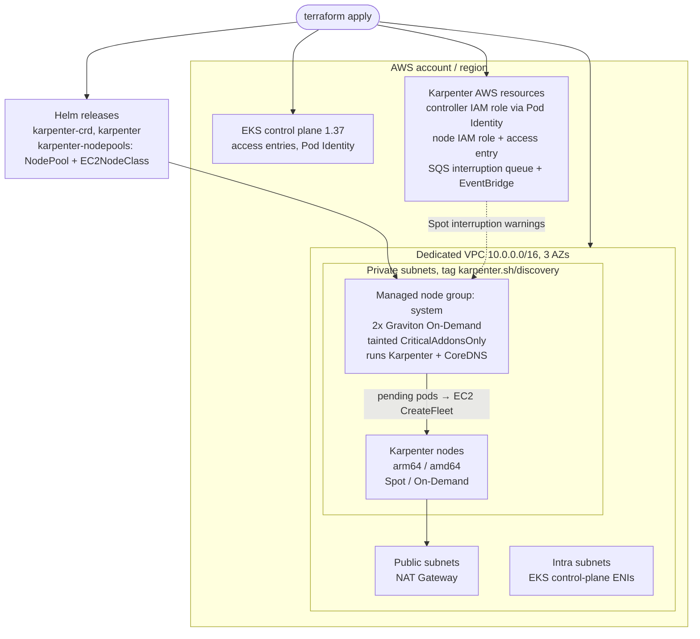

# EKS + Karpenter POC (Graviton and Spot)

Terraform that creates, from scratch:

- a **dedicated VPC** (3 AZs, public / private / intra subnets, NAT),
- an **Amazon EKS 1.37** cluster (latest version at the time of writing),
- **Karpenter 1.15.3** with a NodePool that launches **x86 (amd64) and Graviton (arm64)** nodes on **Spot and On-Demand** capacity.

Developers choose the architecture and capacity type of their workloads with a standard `nodeSelector`; Karpenter provisions matching nodes in about a minute and removes them when they are no longer needed.

## Architecture



| File | What it creates |
|---|---|
| `vpc.tf` | VPC, subnets (private `/19` per AZ, sized for pod IPs), NAT Gateway, Karpenter discovery tags |
| `eks.tf` | EKS cluster, core add-ons, small Graviton managed node group for system components |
| `karpenter.tf` | Karpenter IAM / SQS / EventBridge resources, Karpenter Helm charts, NodePool + EC2NodeClass |
| `charts/karpenter-nodepools/` | Local Helm chart rendering the `EC2NodeClass` and `NodePool` |
| `examples/` | Sample deployments for developers (arm64, amd64, Spot, On-Demand) |

## Prerequisites

- Terraform >= 1.10, AWS CLI v2, kubectl
- AWS credentials for the target account with permissions to create VPC, EKS, IAM, EC2, SQS and EventBridge resources (e.g. an admin role in a sandbox account)
- **Spot service-linked role.** EC2 needs `AWSServiceRoleForEC2Spot` to launch Spot instances. It already exists in any account that has used Spot before:

  ```bash
  aws iam get-role --role-name AWSServiceRoleForEC2Spot >/dev/null 2>&1 \
    && echo "exists, nothing to do" \
    || echo "missing: set create_spot_service_linked_role = true"
  ```

  If it is missing and not created, everything still works, but Karpenter falls back to On-Demand.

## Usage

```bash
cd terraform
cp terraform.tfvars.example terraform.tfvars   # optional: region, name, allowed IPs, tags

terraform init
terraform plan -out tfplan
terraform apply tfplan                         # ~15-20 minutes

# Connect kubectl to the new cluster
$(terraform output -raw configure_kubectl)

kubectl get nodes                              # 2 system nodes
kubectl get pods -n kube-system -l app.kubernetes.io/name=karpenter
kubectl get nodepools,ec2nodeclasses
```

Main inputs (see `variables.tf` for all):

| Variable | Default | Purpose |
|---|---|---|
| `region` | `us-east-1` | AWS region |
| `cluster_name` | `eks-karpenter-poc` | Cluster name, resource prefix and Karpenter discovery tag |
| `kubernetes_version` | `1.37` | EKS version |
| `endpoint_public_access_cidrs` | `["0.0.0.0/0"]` | Who can reach the Kubernetes API. **Restrict to your IP/VPN** |
| `cluster_admin_principal_arns` | `[]` | Extra IAM roles (e.g. SSO roles) with cluster-admin access |
| `karpenter_architectures` | `["arm64", "amd64"]` | Architectures the NodePool may launch |
| `karpenter_capacity_types` | `["spot", "on-demand"]` | Capacity types the NodePool may launch |
| `karpenter_cpu_limit` / `karpenter_memory_limit` | `100` / `400Gi` | Upper bound on Karpenter-managed capacity (cost guardrail) |
| `single_nat_gateway` | `true` | One NAT for the POC; set `false` for one per AZ |

For team use, enable remote state: copy `backend.tf.example` to `backend.tf`, set the bucket and run `terraform init -migrate-state`.

## Developer guide: running on x86 or Graviton

Get cluster access (your IAM role must be in `cluster_admin_principal_arns`, or have its own EKS access entry):

```bash
aws eks update-kubeconfig --region us-east-1 --name eks-karpenter-poc
```

You never create nodes yourself. Describe what your pod needs and Karpenter launches a matching node. Use these well-known labels in `nodeSelector`:

| I want... | `nodeSelector` |
|---|---|
| Graviton (arm64) | `kubernetes.io/arch: arm64` |
| x86 (amd64) | `kubernetes.io/arch: amd64` |
| Spot (cheapest; can be reclaimed with 2-minute notice) | `karpenter.sh/capacity-type: spot` |
| On-Demand (no interruptions) | `karpenter.sh/capacity-type: on-demand` |
| Cheapest available | nothing; Karpenter usually picks Graviton Spot |

### Run a deployment on Graviton (arm64)

```yaml
apiVersion: apps/v1
kind: Deployment
metadata:
  name: my-app
spec:
  replicas: 2
  selector:
    matchLabels: { app: my-app }
  template:
    metadata:
      labels: { app: my-app }
    spec:
      nodeSelector:
        kubernetes.io/arch: arm64        # change to amd64 for x86
      containers:
        - name: app
          image: public.ecr.aws/docker/library/busybox:stable
          command: ["sh", "-c", "while true; do echo arch=$(uname -m); sleep 30; done"]
          resources:                      # requests are required: Karpenter sizes nodes from them
            requests: { cpu: 500m, memory: 256Mi }
            limits:   { memory: 256Mi }
```

Or apply the ready-made examples:

```bash
kubectl apply -f examples/graviton-arm64.yaml    # arm64, Spot if available
kubectl apply -f examples/x86-amd64.yaml         # amd64, Spot if available
kubectl apply -f examples/x86-on-demand.yaml     # amd64, On-Demand only
kubectl apply -f examples/multi-arch-spot.yaml   # any arch, Spot only, spread across AZs
```

Watch Karpenter react and check where pods landed:

```bash
kubectl get nodeclaims -w     # new nodes appear within ~1 minute

kubectl get nodes -L kubernetes.io/arch,karpenter.sh/capacity-type,node.kubernetes.io/instance-type,topology.kubernetes.io/zone
# NAME                          ARCH    CAPACITY-TYPE  INSTANCE-TYPE  ZONE
# ip-10-0-12-34.ec2.internal    arm64   spot           c7g.large      us-east-1a
# ip-10-0-45-67.ec2.internal    amd64   spot           c6a.large      us-east-1b

kubectl logs deploy/demo-arm64   # arch=aarch64 node=...
kubectl logs deploy/demo-amd64   # arch=x86_64  node=...
```

Clean up the examples; Karpenter removes the now-empty nodes after about a minute:

```bash
kubectl delete -f examples/
```

### Things developers should know

- **Images must match the architecture.** An amd64-only image on a Graviton node fails with `exec format error`. Either pin `kubernetes.io/arch: amd64`, or (recommended) build multi-arch images so pods can run on the cheaper Graviton nodes:

  ```bash
  docker buildx build --platform linux/amd64,linux/arm64 -t <account>.dkr.ecr.<region>.amazonaws.com/my-app:1.0.0 --push .
  ```

- **Always set resource requests.** Karpenter picks instance sizes from pod requests; pods without requests get packed too tightly.
- **Spot nodes can disappear with 2 minutes' notice.** Karpenter receives the interruption warning (via the SQS queue), cordons and drains the node, and launches a replacement. Run at least 2 replicas, add a PodDisruptionBudget, and handle `SIGTERM` gracefully. Use On-Demand for anything that cannot be interrupted.
- To protect a pod from voluntary consolidation (e.g. a long batch job), annotate it with `karpenter.sh/do-not-disrupt: "true"`.

## How it works

- **Graviton + Spot by default.** The single `default` NodePool allows both architectures and both capacity types, across instance categories `c`, `m` and `r` of generation 6 or newer. Karpenter chooses the cheapest instance type that fits the pending pods and uses the `price-capacity-optimized` Spot strategy across many instance types, which usually results in Graviton Spot. If Spot capacity is unavailable, it falls back to On-Demand.
- **One `EC2NodeClass` serves both architectures.** The `al2023@latest` AMI alias resolves to the right EKS-optimised Amazon Linux 2023 AMI for arm64 or amd64.
- **Karpenter runs on a small static node group** (2x Graviton On-Demand), because it must not run on nodes it manages. The node group is tainted `CriticalAddonsOnly`, so application pods always go to Karpenter-managed nodes.
- **Consolidation.** Empty or under-used nodes are removed or replaced by cheaper ones after 1 minute, with at most 10% of nodes disrupted at once. Nodes are recycled after 30 days so they pick up new AMIs.
- **Security.** No static credentials: Karpenter uses EKS Pod Identity, and the cluster uses EKS access entries instead of the `aws-auth` ConfigMap. Nodes run in private subnets with IMDSv2 required (hop limit 1, so pods cannot use node credentials), encrypted gp3 volumes, and SSM Session Manager instead of SSH. Kubernetes secrets are encrypted with KMS.

## Cleanup

```bash
kubectl delete -f examples/ --ignore-not-found
terraform destroy
```

`terraform destroy` first removes the NodePool and waits until Karpenter has terminated all nodes it launched, then uninstalls Karpenter and deletes the cluster and VPC. To double-check that nothing is left behind:

```bash
aws ec2 describe-instances \
  --filters "Name=tag:kubernetes.io/cluster/eks-karpenter-poc,Values=owned" "Name=tag-key,Values=karpenter.sh/nodepool" \
            "Name=instance-state-name,Values=pending,running,stopping,stopped" \
  --query 'Reservations[].Instances[].InstanceId'
```

## Troubleshooting

| Symptom | Check |
|---|---|
| Pods stay `Pending`, no NodeClaims | `kubectl logs -n kube-system -l app.kubernetes.io/name=karpenter`, and `kubectl describe pod`: unsatisfiable `nodeSelector`, or NodePool CPU/memory limit reached |
| Logs mention `ServiceLinkedRoleCreationNotPermitted` | The Spot service-linked role is missing: set `create_spot_service_linked_role = true` and apply |
| `exec format error` | The image doesn't support the node's architecture (see multi-arch build above) |
| `terraform apply` can't reach the cluster | Your IP is not in `endpoint_public_access_cidrs` |

## From POC to production

This is intentionally a POC. Before running production workloads:

- Restrict or disable the public API endpoint (VPN / private access only); set `single_nat_gateway = false`.
- Pin the node AMI (`karpenter_ami_alias = "al2023@vYYYYMMDD"`) and roll new versions through environments deliberately.
- Remote state with locking (`backend.tf.example`), and run Terraform from CI with OIDC-based AWS credentials.
- Add separate NodePools where needed: e.g. an On-Demand-only pool for critical services, or GPU / batch pools with taints.
- Install the AWS Load Balancer Controller, metrics-server/HPA, and observability (Prometheus/CloudWatch, Karpenter metrics and alerts).
- Manage cluster add-ons and applications with GitOps (e.g. Argo CD) rather than Terraform.
